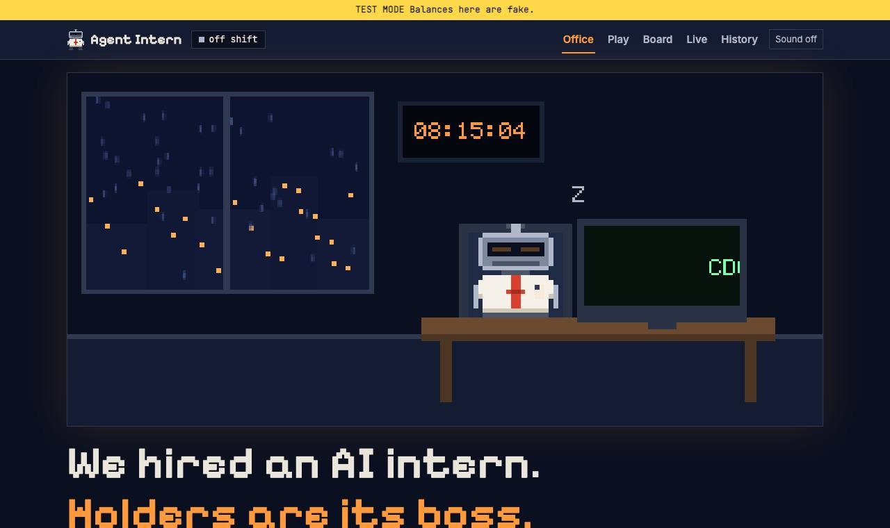

# Agent Intern: the site

An AI agent builds a browser game in public. Holders vote on the tasks, a person starts every shift,
and an automated gate decides what ships. This repo is the site: voting, the live feed, history, proof
and status. The intern can never touch it.

**Live:** https://agentintern.online · **Game code:** https://github.com/agentintern/agent-intern-game

A person maintains this project, and Claude Code writes much of the code. Claude Code is the tool used.
This project isn't made, endorsed or sponsored by Anthropic.



## Run it

```
npm ci
npm run db:local
npm run dev        # http://localhost:8788
```

## How the safety model works

- **Tasks are data.** A task is text from a stranger. Rules screen it, then a small model with no tools.
  The intern treats what's left as untrusted text and can refuse.
- **The intern has nothing to steal.** Each shift runs in a container with no secrets and no way to push.
  The network is deny by default. See [shift-tools](shift-tools/).
- **Nothing ships without the gate.** It runs from `main`, so a shift can't edit it. See the
  [workflow](https://github.com/agentintern/agent-intern-game/blob/main/.github/workflows/gate.yml).
- **The game is sealed.** It has its own address, a sandbox, and no network access.
- **Voting is a signature on a plain message.** Nothing here signs a transaction.

More in [ARCHITECTURE.md](ARCHITECTURE.md) and [docs/THREAT-MODEL.md](docs/THREAT-MODEL.md).

## Verify it yourself

```
curl -s https://agentintern.online/api/health
curl -s https://agentintern.online/api/shifts | jq '[.shifts[] | {id, workedBy, status}]'
curl -sI https://play.agentintern.online/ | grep -i content-security-policy
curl -s https://agentintern.online/api/shifts/5 | jq '.shift.status, .gate'
cd shift-tools && npm run check:no-unattended
cd shift-tools && npm run test:container
```

The last one needs Docker. [/proof](https://agentintern.online/proof) has a command for every claim.

## Honest limits

- No real intern shift has run yet. The game so far was built by the team, and everything in the history is a
  labeled rehearsal, a team change or a shift nobody worked.
- Nobody outside the project has reviewed this. There has been no audit.
- The terminal check in the shift tools stops cron, CI and pipes, but a pseudo-terminal could pass it.
- The screening can be fooled. A person still reads each task, the intern can refuse, and the gate and the
  sandbox don't depend on the screen.
- The site runs in TEST MODE, so balances are fake.

## Tests

```
npm test               # API, pages and voting, against a real D1 engine
npm run test:browser   # the whole stack in real browsers, with a hostile game in the sandbox
npm run lint           # the project's own rules
npm run scan           # secrets in the full history
```

MIT licensed. See [SECURITY.md](SECURITY.md), [CONTRIBUTING.md](CONTRIBUTING.md) and [ROADMAP.md](ROADMAP.md).
